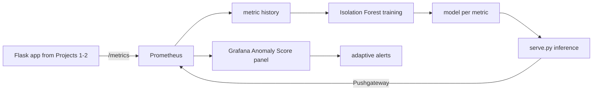

# Architecture — ML Anomaly Detection Monitoring

## Components

- `monitoring/docker-compose.yml` — Prometheus + Grafana, local only.
- `monitoring/prometheus.yml` — scrape the Flask app (`/metrics` via
  `prometheus_client`, added to the app Day 2) and Prometheus itself.
- `monitoring/grafana/` — datasource + dashboard provisioning and the
  App Health dashboard (App up + Anomaly Score panels).
- `anomaly-detector/` (Day 5–6) — `train.py` (Isolation Forest on
  history; seeded with k6 load-test runs, then retrained on real
  collected history) and `serve.py` (FastAPI endpoint scoring the
  latest metrics, pushing the score to the Pushgateway).
- Static thresholds stay as a fallback, clearly labelled as such.

## Decisions

- **Self-hosted first.** Prometheus + Grafana in Docker Compose (or
  in the Minikube cluster from Project 4), or Grafana Cloud free tier.
  No paid monitoring.
- **Learned baselines, not magic.** The model trains on real history;
  the 40–60% fewer-false-positives target is tested against the same
  load-test scenarios, not claimed in advance.
- **Seeding is honest.** History is seeded with k6 load-test runs
  from Project 4 because a fresh system has no history yet — and the
  README says so.
